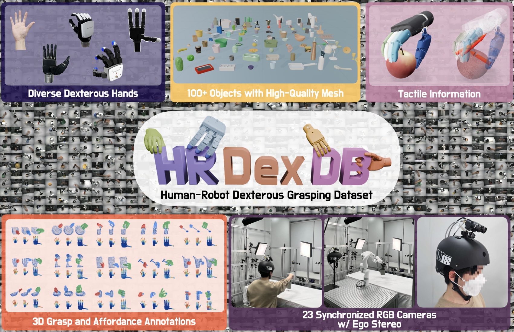

<div align="center">

# 🤖 HRDexDB

### A Paired Human-Robot Dataset for Cross-Embodiment Dexterous Grasping

Jongbin Lim<sup>1,&ast;</sup> · Taeyun Ha<sup>1,&ast;</sup> · Seongho Cha<sup>1</sup> · Kanghyeon Cho<sup>1</sup> · Mingi Choi<sup>1</sup> · Subin Jeon<sup>1</sup> · Jisoo Kim<sup>1</sup> · Byungjun Kim<sup>1</sup> · Hanbyul Joo<sup>1,2,†</sup>

<sup>1</sup> Seoul National University · <sup>2</sup> RLWRLD

<sup>*</sup> Equal contribution · <sup>†</sup> Corresponding author

[📄 Paper](https://arxiv.org/abs/2604.14944) |
[🌐 Project Page](https://snuvclab.github.io/HRDexDB/) |
[📦 Dataset](https://huggingface.co/datasets/HRDexDB/HRDexDB) |
[👀 Visualizer](https://snuvclab.github.io/HRDexDB/gallery-index.html)

</div>

Official dataset repository and lightweight visualization toolkit for **HRDexDB**.

<p align="center">
  <b>TL;DR:</b> HRDexDB is a paired cross-embodiment dataset of high-fidelity dexterous grasping sequences featuring both human and robotic hands.
</p>

<p align="center">
  
</p>

## Dataset Overview

HRDexDB provides paired dexterous grasping trajectories across human hands and robotic hand embodiments, captured on the same target objects under comparable grasping motions. The dataset includes synchronized visual, kinematic, and 3D annotation modalities, with contact-force signals available for tactile-enabled robot hands.

Key statistics:

- **2.1K** grasping sequences
- **100+** diverse objects
- **5** hand embodiments
- **23** synchronized cameras
- High-precision 3D trajectories for both hand/robot and manipulated objects

## Installation

```bash
git clone https://github.com/snuvclab/HRDexDB
cd HRDexDB

conda env create -f environment.yml
conda activate hrdexdb-vis
```

For an existing Python environment:

```bash
pip install -r requirements.txt
```

All commands below assume they are run from the repository root.

## Dataset Download

The full dataset is about 1.6 TB and is available from two sources:

- [Hugging Face](https://huggingface.co/datasets/HRDexDB/HRDexDB) stores individual files. Use it to download specific objects, scenes, or file types.
- [Google Drive](https://drive.google.com/drive/folders/1MgaQ8oxE97T30W0x4lte1EM0U7fl3bzl?usp=sharing) stores each hand's data as one `.tar.gz` archive per object. Use it to download whole subsets.

| Subset | Size | Files on Hugging Face | Archives on Google Drive |
| --- | --- | --- | --- |
| `human` | 108 GB | 239,003 | 94 |
| `allegro_v5` | 254 GB | 16,761 | 91 |
| `inspire_f1` | 352 GB | 23,646 | 92 |
| `inspire_dftp` | 548 GB | 27,192 | 84 |
| `robotiq_2f85` | 305 GB | 26,517 | 91 |

### Whole subsets from Google Drive

Downloading a folder through the Google Drive website requires preparing a ZIP first, which is slow for folders this large. Use [rclone](https://rclone.org/drive/) instead. Create a Google Drive remote named `hrdexdb_drive` with `rclone config`, using [your own client ID](https://rclone.org/drive/#making-your-own-client-id), then choose the folders to download:

```bash
ROOT=1MgaQ8oxE97T30W0x4lte1EM0U7fl3bzl
FILTERS=(
  --include "/allegro_v5/**"
  --include "/inspire_f1/**"
  --include "/inspire_dftp/**"
  --include "/assets/**"
  --include "/metadata/**"
  --include "/object_6d_pose_v2/**"
)

rclone copy hrdexdb_drive: ./hrdexdb_drive --drive-root-folder-id "$ROOT" "${FILTERS[@]}" --transfers 4 -P
```

rclone verifies each file after transfer and skips completed files when re-run, so you can repeat the same command after an interruption. A partially downloaded file restarts from the beginning. To check everything against the MD5 checksums stored by Google Drive:

```bash
rclone check hrdexdb_drive: ./hrdexdb_drive --drive-root-folder-id "$ROOT" "${FILTERS[@]}" --one-way
```

Then extract the archives into `v0`. The `inspire_dftp` archives contain no subset folder, so they are extracted one level deeper:

```bash
mkdir -p v0/inspire_dftp
for f in hrdexdb_drive/inspire_dftp/*.tar.gz; do tar -xzf "$f" -C v0/inspire_dftp; done

for s in human allegro_v5 inspire_f1 robotiq_2f85; do
  [ -d "hrdexdb_drive/$s" ] || continue
  for f in "hrdexdb_drive/$s"/*.tar.gz; do tar -xzf "$f" -C v0; done
done

cp -r hrdexdb_drive/assets hrdexdb_drive/metadata hrdexdb_drive/object_6d_pose_v2 v0/
```

### Selected files from Hugging Face

Use `--include` to limit a download. Re-running the command skips files that are already complete:

```bash
hf download HRDexDB/HRDexDB --repo-type dataset --local-dir v0 \
  --include "inspire_f1/banana/*" \
  --include "assets/*" \
  --include "metadata/*"
```

If you don't need the videos, add `--exclude "*.mp4"`. Without videos, the five subsets total about 20 GB:

```bash
hf download HRDexDB/HRDexDB --repo-type dataset --local-dir v0 \
  --include "inspire_f1/*" \
  --exclude "*.mp4"
```

Downloading many files at once can trigger Hugging Face rate limits (HTTP 429). If this happens, log in with `hf auth login` and lower `--max-workers`.

## Dataset Placement

Place the released dataset folder `v0` directly under the repository root:

```text
HRDexDB/
├── README.md
├── visualize_trajectory.py
├── hrdexdb/
├── assets/
│   └── robots/
└── v0/
    ├── assets/
    │   └── mesh/
    │       └── <object_name>/
    │           └── <object_name>.obj
    ├── human/
    │   └── <object_name>/
    │       └── <scene_id>/
    └── inspire_f1/
        └── <object_name>/
            └── <scene_id>/
```

By default, the viewer resolves:

- dataset root: `./v0`
- object mesh root: `./v0/assets/mesh`

If `v0` is stored elsewhere, pass `--dataset-root /path/to/v0`. The mesh root then defaults to `/path/to/v0/assets/mesh`.

## Quick Visualization

Visualize an Inspire F1 robot scene:

```bash
python visualize_trajectory.py \
  --hand inspire_f1 \
  --object banana \
  --scene 2
```

Visualize a human hand scene:

```bash
python visualize_trajectory.py \
  --hand human \
  --object banana \
  --scene 2
```

Use a dataset stored outside the repository:

```bash
python visualize_trajectory.py \
  --dataset-root /path/to/v0 \
  --hand inspire_f1 \
  --object french_mustard \
  --scene 2
```

## Expected Scene Layout

Each scene is expected to follow this structure:

```text
<dataset-root>/<hand>/<object>/<scene_id>/
├── cam_param/
│   ├── intrinsics.json
│   ├── extrinsics.json
│   └── ego_calib.json          # optional, for human ego cameras
├── C2R.npy                    
├── object_6d/
│   └── pose_*.txt
└── vid/
    └── <camera_id>.mp4

<dataset-root>/assets/mesh/<object>/<object>.obj
```

Robot scenes additionally include:

```text
raw/
├── arm/*.npy
├── hand/*.npy
└── timestamps/
    ├── timestamp.npy
    └── frame_id.npy
```

Human scenes include MANO mesh sequences under one of:

```text
hand/mano/*.obj
```

## Contact

For questions, please contact [Jongbin Lim](https://jongbinlim.github.io/) at [whdqls0534@snu.ac.kr](mailto:whdqls0534@snu.ac.kr) or [Taeyun Ha](https://hahahataeyun.github.io/) at [taeyun012@snu.ac.kr](mailto:taeyun012@snu.ac.kr).

## Citation

If you find HRDexDB useful, please cite:

```bibtex
@misc{lim2026hrdexdb,
      title={HRDexDB: A Paired Human-Robot Dataset for Cross-Embodiment Dexterous Grasping},
      author={Jongbin Lim and Taeyun Ha and Mingi Choi and Jisoo Kim and Byungjun Kim and Subin Jeon and Hanbyul Joo},
      year={2026},
      eprint={2604.14944},
      archivePrefix={arXiv},
      primaryClass={cs.RO},
      url={https://arxiv.org/abs/2604.14944},
}
```
